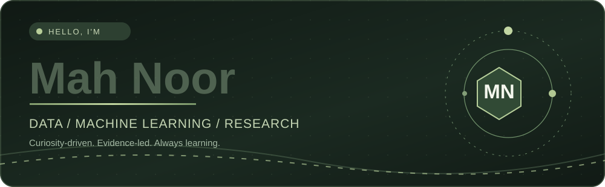
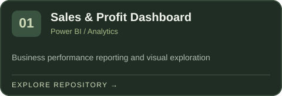
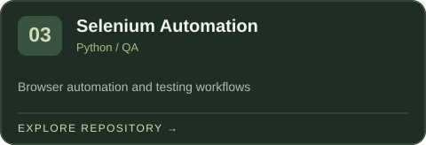
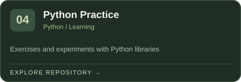
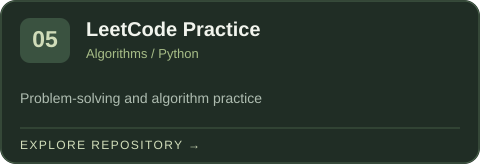
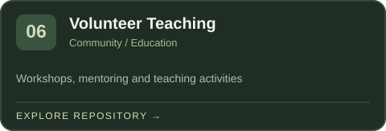
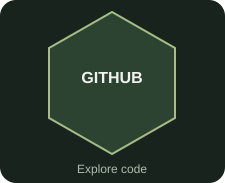
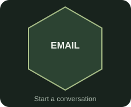

 

 

[**Portfolio**](https://mah-noor11.github.io/) &nbsp; · &nbsp; [**Academic CV**](./assets/Mah-Noor-Academic-CV.pdf) &nbsp; · &nbsp; [**LinkedIn**](https://www.linkedin.com/in/ma-h-noor/)

 

I'm **Mah Noor**, an Information Technology graduate interested in the intersection of **data analysis, machine learning, and practical AI research**. My experience includes working with datasets, annotation, OCR, preprocessing, model-error analysis, Python learning activities, and software QA.

I'm building toward **research-oriented graduate study**. I want to better understand how models behave, how data quality changes their results, and how to evaluate intelligent systems with care.

> I care about asking useful questions, validating results, and turning curiosity into practical work.

<table><tr><td width="50%" valign="top">

**Now exploring**

- Machine learning evaluation
- Data visualization and analytics
- Generative AI and model behavior

</td><td width="50%" valign="top">

**Open to**

- Research collaborations
- Python and analytics projects
- Academic learning communities

</td></tr></table>

**Programming & data**

**Analysis, testing & workflow**

 

<table>
<tr>
<td width="50%"></td>
<td width="50%"></td>
</tr>
<tr>
<td></td>
<td></td>
</tr>
<tr>
<td></td>
<td></td>
</tr>
</table>

I'm interested in **reliable and responsible AI**, especially how data quality, annotation decisions, model evaluation, and shifting real-world conditions affect outcomes. My goal is to grow from applying tools to designing reproducible experiments and making evidence-based improvements.

Live activity is provided by an external service and may occasionally be unavailable.

<table>
<tr>
<td></td>
<td></td>
<td></td>
<td></td>
</tr>
</table>

