

<picture>
  <source media="(prefers-color-scheme: dark)" srcset="assets/identity/identity-dark.gif" />
  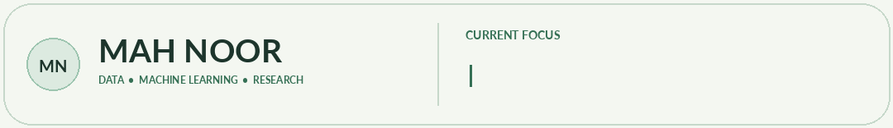
</picture>

 
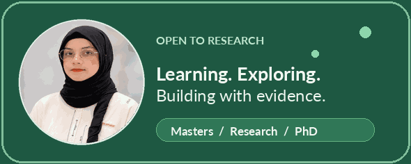

<a href="https://mah-noor11.github.io/">Portfolio</a> &nbsp; • &nbsp; <a href="assets/Mah-Noor-Academic-CV.pdf">Academic CV</a> &nbsp; • &nbsp; <a href="https://www.linkedin.com/in/ma-h-noor/">LinkedIn</a>

---

## About Me

I’m **Mah Noor**, an Information Technology graduate exploring the intersection of data, machine learning, and real-world AI applications. I’ve worked with datasets, annotation, OCR, preprocessing, and model-error analysis, and I enjoy supporting others as they learn Python.

I’m preparing for **research-oriented Master’s opportunities**, with a long-term interest in **PhD study and AI research**. My research interests are evolving through hands-on learning and experimentation.

**Explore more — click a card:**

<table>
<tr>
<td width="50%" valign="top">

Model evaluation, data quality, generative AI, and practical machine-learning workflows.

</td>
<td width="50%" valign="top">

Trustworthy AI, model reliability, applied AI, reproducible experiments, and research-led graduate education.

</td>
</tr>
<tr>
<td valign="top">

Data analysis and annotation, Python teaching, course moderation, software QA, and collaborative technical projects.

</td>
<td valign="top">

Funded Master’s scholarships, research assistantships, academic collaborations, mentoring, and AI/ML projects.

</td>
</tr>
</table>

## Research Interests

<em>Exploring questions about data quality, model behavior, and responsible AI development.</em>

<table>
<tr>
<td width="50%" valign="top">

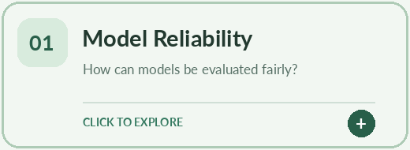

Interested in understanding failure cases, evaluation design, and whether AI systems behave reliably under changing conditions.

</td>
<td width="50%" valign="top">

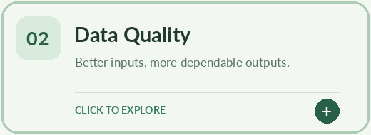

Exploring how annotation, incomplete records, preprocessing, and dataset choices influence downstream model performance.

</td>
</tr>
<tr>
<td valign="top" colspan="2" align="center">

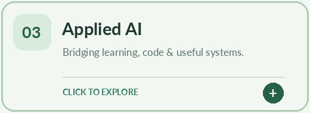

Building skills in Python, machine learning, generative AI, and practical software workflows for useful problems.

</td>
</tr>
</table>

## Quick Facts

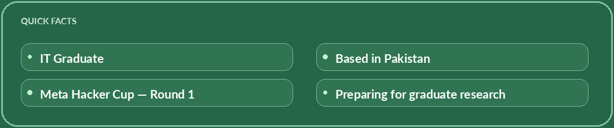

## Skills & Tools

<!-- Icon-only section: each image has a descriptive tooltip / alternative text. -->
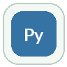     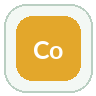  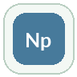 
 

 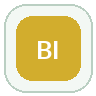 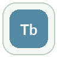 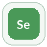     

Skill names appear on hover where supported.

## Featured Repositories

Click a project card to see what it covers and open its GitHub repository.

<table>
<tr>
<td width="50%" valign="top">

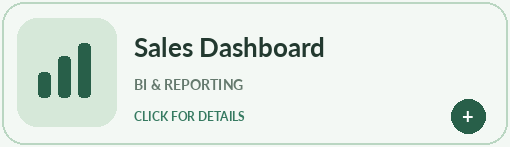

<strong>Sales & Profit Dashboard</strong>

An exploration of business reporting and dashboard visualization in Power BI.

↗ <a href="https://github.com/Mah-Noor11/Sales_dashboard"><strong>Open Repository on GitHub</strong></a>

</td>
<td width="50%" valign="top">

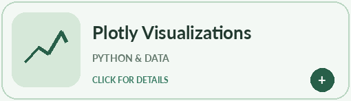

<strong>Plotly Visualizations</strong>

Python notebook work exploring interactive plots and visual interpretation.

↗ <a href="https://github.com/Mah-Noor11/plots_data"><strong>Open Repository on GitHub</strong></a>

</td>
</tr>
<tr>
<td width="50%" valign="top">

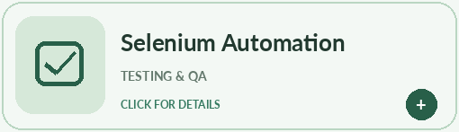

<strong>Selenium Automation</strong>

Browser-based QA automation and test workflow practice in Python.

↗ <a href="https://github.com/Mah-Noor11/selenium_work"><strong>Open Repository on GitHub</strong></a>

</td>
<td width="50%" valign="top">

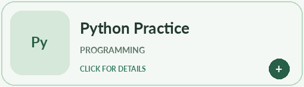

<strong>Python Practice</strong>

A collection of fundamental Python exercises and library experiments.

↗ <a href="https://github.com/Mah-Noor11/Python"><strong>Open Repository on GitHub</strong></a>

</td>
</tr>
<tr>
<td width="50%" valign="top">

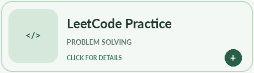

<strong>LeetCode Practice</strong>

Algorithmic programming exercises and independent problem-solving practice.

↗ <a href="https://github.com/Mah-Noor11/Leetcode"><strong>Open Repository on GitHub</strong></a>

</td>
<td width="50%" valign="top">

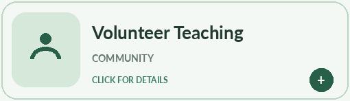

<strong>Volunteer Teaching</strong>

Workshops, volunteer teaching, course moderation, and community activities.

↗ <a href="https://github.com/Mah-Noor11/Volunteer-Teaching-Activities"><strong>Open Repository on GitHub</strong></a>

</td>
</tr>
</table>

## GitHub Activity

<table>
<tr>
<td width="50%"><a href="https://github.com/Mah-Noor11?tab=repositories">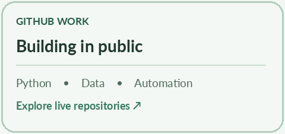</a></td>
<td width="50%"><a href="https://github.com/Mah-Noor11?tab=repositories">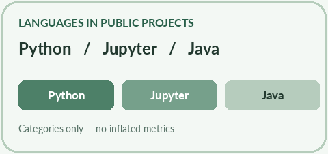</a></td>
</tr>
</table>

Streak data is live and depends on the external stats service. The summary cards above are bundled locally and never display invented counts.

## Where I’m Heading

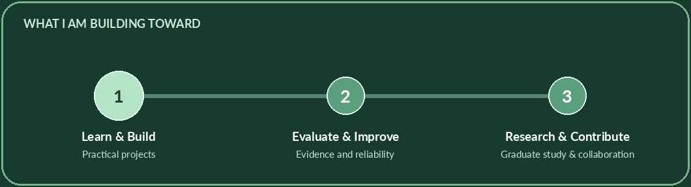

My goal is to go beyond applying machine-learning tools and develop the research skills needed to ask better questions, evaluate systems carefully, and make evidence-based improvements. **Graduate study and collaborative research are my next steps.**

## Let's Connect

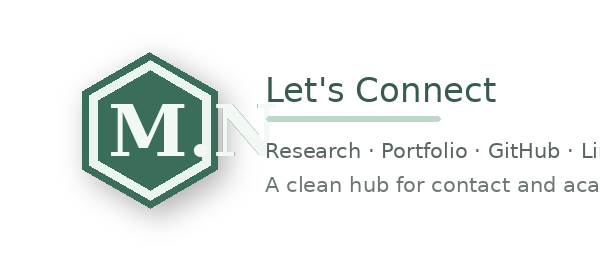

Choose a hexagon to open a link.

<a href="https://github.com/Mah-Noor11">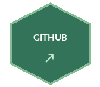</a>
<a href="mailto:mahnoortech738@gmail.com">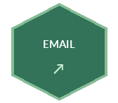</a>
<a href="assets/Mah-Noor-Academic-CV.pdf">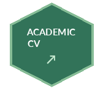</a>

 
Learn with curiosity. Build with care. Grow through research.

