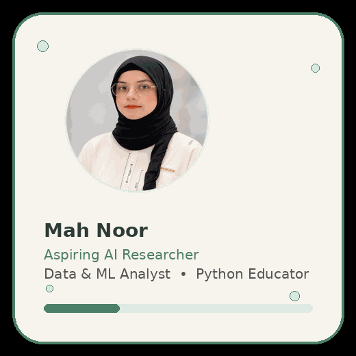
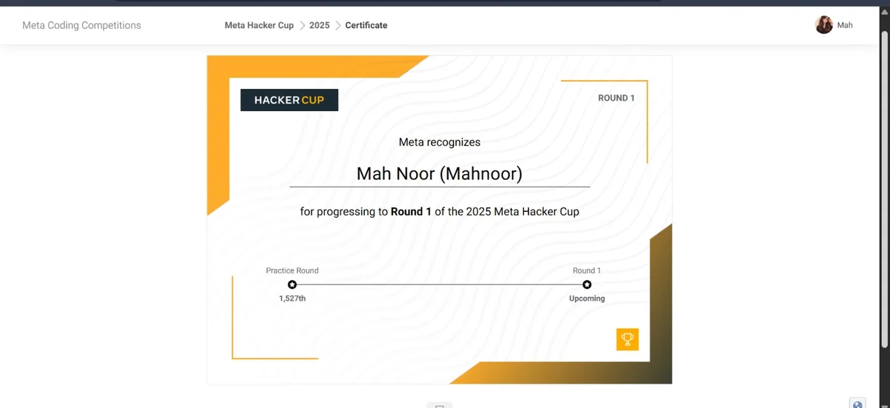
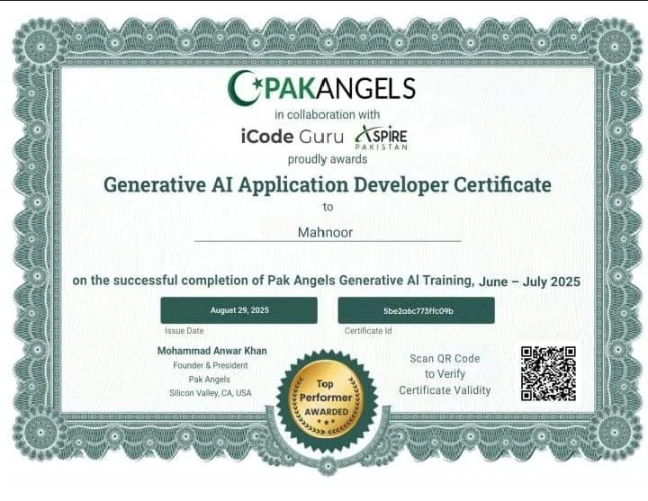
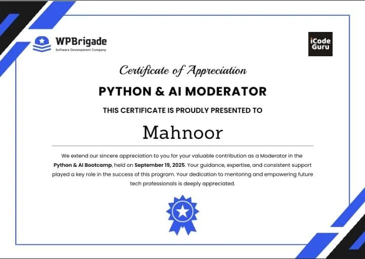
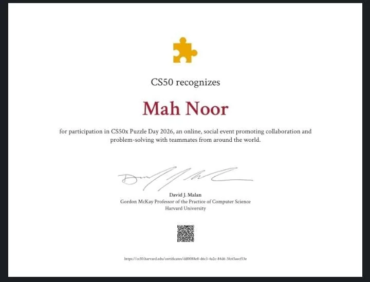
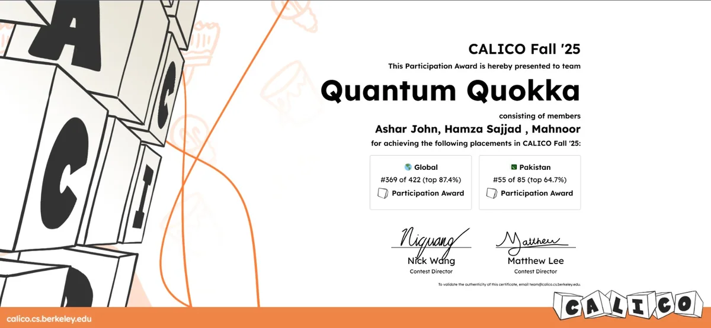
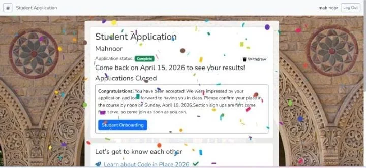

<picture>
  <source media="(prefers-color-scheme: dark)" srcset="assets/banner-dark.png">
  
</picture>

 

  

---

## About Me

Hi, I'm **Mah Noor** — an Information Technology graduate with practical experience in **data analysis, machine-learning workflows, technical teaching, and AI learning projects**.

- 🌱 **Currently growing in:** model evaluation, data quality, generative AI, and applied machine learning
- 🔍 **Interested in:** reliable AI systems, research-oriented Master's study, and future PhD pathways
- 🧑‍🏫 **Experience includes:** Python teaching, moderation, QA practice, and hands-on student support
- 🤝 **Open to:** research collaborations, funded scholarships, AI/ML learning opportunities, and academic networking

> **Professional bio:** *Aspiring AI Researcher | Data & ML Analyst | Python & AI Educator*

---

## Visual Snapshot

<table>
<tr>
<td width="52%" valign="top">

### Research & Career Direction
- **Applied AI & ML**
- **Data analysis & visualization**
- **Model evaluation & reliability**
- **Python education & community learning**
- **Research-focused Master's opportunities**

</td>
<td width="48%" valign="top">

### Quick Facts
- 🎓 IT Graduate
- 📍 Based in Pakistan
- 💼 Data / ML / Research-oriented background
- 🏆 Meta Hacker Cup Round 1 qualifier
- 📚 Building toward research and postgraduate study

</td>
</tr>
</table>

---

## GitHub Activity

  
  

  

---

## Tech Stack

   
  
  
  
  
  
  
  
  
  

### Skills at a glance

| Area | Skills |
| --- | --- |
| **Data & Visualization** | Power BI, Tableau, Pandas, NumPy, Plotly, Matplotlib, Excel, Google Sheets |
| **Programming** | Python, Java, XML, Jupyter Notebook, Google Colab |
| **Machine Learning** | dataset preparation, annotation, OCR, preprocessing, model evaluation, supervised & unsupervised learning concepts |
| **Testing & Workflow** | Selenium, manual QA, TestRail, Jira, Hubstaff, project coordination |
| **Currently Exploring** | chatbots, generative AI, ML improvement workflows, deeper research methods |

---

## Featured Repositories

<table>
<tr>
<td width="50%" valign="top">

### 📊 [Sales Dashboard](https://github.com/Mah-Noor11/Sales_dashboard)
Power BI dashboard for business-data insights, reporting, and communication.

</td>
<td width="50%" valign="top">

### 📈 [Plotly Visualizations](https://github.com/Mah-Noor11/plots_data)
Interactive charting practice using Python notebooks and visual storytelling.

</td>
</tr>
<tr>
<td valign="top">

### 🧪 [Selenium Automation](https://github.com/Mah-Noor11/selenium_work)
Automation testing and browser workflow practice using Selenium.

</td>
<td valign="top">

### 💻 [Python Practice](https://github.com/Mah-Noor11/Python)
Core Python practice covering loops, functions, conditions, and libraries.

</td>
</tr>
<tr>
<td valign="top">

### 🧠 [LeetCode Practice](https://github.com/Mah-Noor11/Leetcode)
Problem-solving and algorithm exercises for logic building and coding fluency.

</td>
<td valign="top">

### 🌍 [Volunteer Teaching Activities](https://github.com/Mah-Noor11/Volunteer-Teaching-Activities)
Community record of workshops, training sessions, moderation, and mentoring.

</td>
</tr>
</table>

---

## Highlights, Certificates & Community

<table>
<tr>
<td align="center" width="33%"> <strong>Meta Hacker Cup 2025</strong> Qualified for Round 1</td>
<td align="center" width="33%"> <strong>Generative AI Developer</strong> PakAngels · Top Performer</td>
<td align="center" width="33%"> <strong>Python & AI Moderator</strong> WPBrigade × iCodeGuru</td>
</tr>
<tr>
<td align="center"> <strong>CS50x Puzzle Day 2026</strong> Collaboration & problem solving</td>
<td align="center"> <strong>CALICO Fall '25</strong> Team Quantum Quokka</td>
<td align="center"> <strong>Stanford Code in Place</strong> Selected as student participant</td>
</tr>
</table>

---

## What I'm Building Toward

I'm moving from using tools toward understanding **how data quality, evaluation, and machine-learning decisions affect results**. My long-term goal is to contribute to **AI and computer-science research** through graduate study, meaningful projects, and collaborative learning.

---

## Let's Connect

  
<strong>Learning with curiosity • Working with evidence • Growing toward research</strong>

