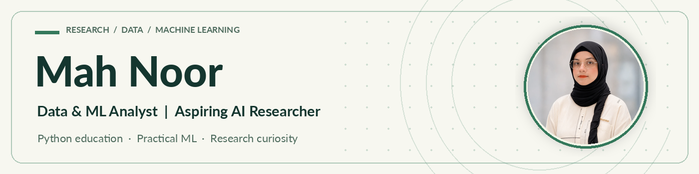

<picture>
  <source media="(prefers-color-scheme: dark)" srcset="assets/banner-dark.png">
  
</picture>

### Data Analytics · Machine Learning · Applied AI · Python Education

[**Portfolio**](https://mah-noor11.github.io/) &nbsp; · &nbsp; [**Academic CV**](assets/Mah-Noor-Academic-CV.pdf) &nbsp; · &nbsp; [**LinkedIn**](https://www.linkedin.com/in/ma-h-noor/) &nbsp; · &nbsp; [**Email**](mailto:mahnoortech738@gmail.com)

## About me

I'm **Mah Noor**, an Information Technology graduate with hands-on experience in data analysis, machine-learning workflows, and technical education. My work has involved dataset annotation, OCR, preprocessing, and reviewing model errors to better understand how data quality affects predictions.

I enjoy exploring practical AI systems, documenting what I learn, and helping others develop their Python skills. I'm preparing for **research-oriented Master's opportunities**, with a long-term goal of doctoral study in computer science or AI.

> **Open to:** Funded Master's scholarships · Research assistantships · Academic collaborations · AI/ML learning opportunities

## Research direction

| **01 / Model reliability** | **02 / Data quality** | **03 / Applied & generative AI** |
| :--- | :--- | :--- |
| Exploring evaluation, prediction errors, and model improvement. | Interested in annotation, preprocessing, evidence quality, and reproducible workflows. | Learning how ML and generative AI tools can solve useful problems. |

These are developing research interests, not claims of published research.

## Selected work

<table>
<tr>
<td width="50%" valign="top">
  
<strong><a href="https://github.com/Mah-Noor11/Sales_dashboard">Sales &amp; Profit Dashboard</a></strong>

  
Power BI report demonstrating business-data presentation and dashboard communication.

  Business intelligence · Reporting
</td>
<td width="50%" valign="top">
  
<strong><a href="https://github.com/Mah-Noor11/plots_data">Plotly Visualizations</a></strong>

  
Jupyter notebook experiments with interactive plotting and visual interpretation.

  Python · Jupyter · Plotly
</td>
</tr>
<tr>
<td valign="top">
  
<strong><a href="https://github.com/Mah-Noor11/selenium_work">Selenium Automation</a></strong>

  
Python-based browser testing and quality-assurance practice.

  Python · Selenium · QA
</td>
<td valign="top">
  
<strong><a href="https://github.com/Mah-Noor11/Python">Python Practice</a></strong>

  
Exercises in Python fundamentals, functions, conditions, loops, and libraries.

  Python · Programming fundamentals
</td>
</tr>
<tr>
<td valign="top">
  
<strong><a href="https://github.com/Mah-Noor11/Leetcode">Problem-Solving Practice</a></strong>

  
Algorithmic problem-solving and coding exercises.

  DSA · Python
</td>
<td valign="top">
  
<strong><a href="https://github.com/Mah-Noor11/Volunteer-Teaching-Activities">Teaching &amp; Mentoring</a></strong>

  
A record of workshops, moderation, and volunteer technical education.

  Community · Education
</td>
</tr>
</table>

## Skills & tools

| Area | Tools and experience |
| :--- | :--- |
| **Data & visualization** | Power BI, Tableau, Excel, Pandas, NumPy, Matplotlib, Plotly |
| **Programming & notebooks** | Python, Jupyter Notebook, Google Colab, Git, GitHub |
| **Machine learning** | Dataset preparation, annotation, supervised/unsupervised learning concepts, model evaluation, OCR, OpenCV (exploring) |
| **Testing & workflow** | Selenium, manual QA, TestRail, Jira, Hubstaff |
| **Currently exploring** | Generative AI, chatbots, ML model improvement, reproducible experiments |

## Competitions, training & community

| Year | Experience | Evidence |
| :---: | :--- | :---: |
| 2025 | **Meta Hacker Cup:** advanced from Practice Round to Round 1. Practice Round placement **1,527th**. | [Certificate](assets/credentials/meta-hacker-cup-2025.webp) |
| 2026 | **Harvard CS50x Puzzle Day:** participated in collaborative logic and problem-solving challenges. | [Certificate](assets/credentials/cs50-puzzle-day-2026.webp) |
| 2025 | **UC Berkeley CALICO Fall:** competed with team *Quantum Quokka*. | [Certificate](assets/credentials/calico-fall-2025.webp) |
| 2025 | **Generative AI Application Developer:** completed PakAngels training; certificate carries a *Top Performer* seal. | [Certificate](assets/credentials/genai-developer-2025.webp) |
| 2025 | **Python & AI Moderator:** recognized by WPBrigade and iCodeGuru for bootcamp moderation. | [Certificate](assets/credentials/python-ai-moderator-2025.webp) |
| 2026 | **Stanford Code in Place:** accepted as a **student** in the Python learning program. | [Acceptance record](assets/credentials/stanford-code-in-place-2026.webp) |

## Where I'm headed

My goal is to move from applying machine-learning tools toward understanding **why models succeed or fail**, how they can be evaluated fairly, and how to make AI results more reliable. I'm interested in contributing to research groups through graduate study, hands-on projects, and collaborative experimentation.

**Interested in research, mentoring, or collaborating?**

[Explore my portfolio](https://mah-noor11.github.io/) · [View my CV](assets/Mah-Noor-Academic-CV.pdf) · [Connect on LinkedIn](https://www.linkedin.com/in/ma-h-noor/)

Learning with curiosity. Working with evidence. Sharing what I learn.

